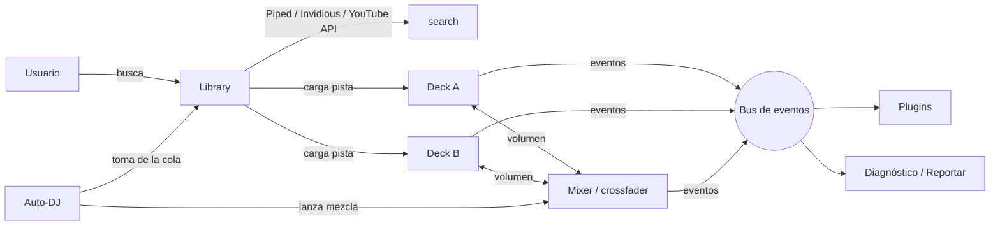

# Arquitectura de DjClaudeBrave

Este documento explica cómo está hecho DjClaudeBrave, para que cualquier persona (o Claude) pueda entenderlo, repararlo y hacerlo crecer.

## Principios

1. **Plug and play.** Se abre un enlace y funciona. Sin instalar, sin cuentas, sin compilar.
2. **Un núcleo en un solo archivo.** Todo lo esencial vive en [`index.html`](index.html). Si ese archivo está, la app funciona.
3. **Extensiones opcionales.** Las funciones nuevas pueden llegar como plugins en [`plugins/`](plugins/). Si un plugin falla o falta, el núcleo sigue funcionando.
4. **Family Open.** Gratis, abierto, sin rastreo ni anuncios, apto para toda la familia. Ninguna contribución puede romper esto (ver [CONTRIBUTING.md](CONTRIBUTING.md)).

## Estructura del repositorio

```
DjClaudeBrave/
├── index.html            Núcleo completo: HTML + CSS + JavaScript
├── assets/
│   ├── djclaudebrave.jpg Ilustración del proyecto (README)
│   ├── logo.png          Logo circular de la app
│   ├── favicon.png       Ícono de la pestaña
│   └── social.jpg        Imagen que aparece al compartir el enlace
├── plugins/
│   ├── README.md         Cómo escribir un plugin
│   └── historial.js      Plugin de ejemplo: historial de la sesión
├── .github/
│   └── ISSUE_TEMPLATE/   Plantillas para reportar problemas y proponer ideas
├── ARCHITECTURE.md       Este documento
├── CLAUDE.md             Instrucciones para que Claude trabaje en el proyecto
├── CONTRIBUTING.md       Cómo reportar, proponer y contribuir
├── CHANGELOG.md          Historial de versiones
├── README.md             Presentación del proyecto (español)
├── README.en.md          Presentación del proyecto (inglés)
├── LICENSE               MIT
└── .nojekyll             Publica tal cual en GitHub Pages
```

## Módulos del núcleo

Dentro del `<script>` de `index.html`, el código está separado en secciones marcadas con `/* ===== nombre.js ===== */`:

| Módulo | Responsabilidad |
|---|---|
| `ui` | Avisos en pantalla (`toast`), almacenamiento local seguro (`store`), escape de HTML (`esc`) |
| `youtube` | Carga del IFrame API de YouTube, lectura de enlaces (`parseVideoId`), títulos vía oEmbed, formato de tiempo |
| `search` | Búsqueda sin clave en instancias públicas de Piped e Invidious, con respaldo automático; usa la clave de YouTube Data API si existe |
| `deck` | Clase `Deck`: un reproductor de YouTube con transporte, CUE, hot cues, tempo, Tap BPM, Nudge y detección de videos bloqueados |
| `mixer` | Clase `Mixer`: crossfader con curvas y transiciones automáticas por volumen |
| `library` | Clase `Library`: resultados de búsqueda y cola persistente, con arrastrar y soltar |
| `app` | Conecta todo: mezcla, Sync, Auto‑DJ, teclado, bus de eventos, API de plugins, diagnóstico y reporte |

## Flujo de datos



## Bus de eventos

El núcleo emite eventos que cualquier plugin puede escuchar con `api.on(tipo, función)`:

| Evento | Cuándo ocurre | Datos |
|---|---|---|
| `track:load` | Se carga una pista en un deck | `{ deck, track }` |
| `deck:play` | Un deck empieza a sonar | `{ deck, track }` |
| `deck:pause` | Un deck se pausa | `{ deck, track }` |
| `deck:end` | Una pista termina | `{ deck, track }` |
| `deck:error` | Una pista no se puede reproducir | `{ deck, track, reason }` |
| `deck:alternative` | Se cargó otra versión reproducible de una pista bloqueada | `{ deck, from, to }` |
| `mix:start` | Empieza una mezcla | `{ from, to, seconds }` |
| `mix:end` | Termina o se interrumpe una mezcla | `{ from, to, completed }` |

`track` tiene la forma `{ id, title?, channel?, duration? }`, donde `id` es el ID de YouTube de 11 caracteres.

## API de plugins

`window.DjClaudeBrave.use(plugin)` registra un plugin. Un plugin es `{ name, setup(api) }`. El objeto `api` ofrece:

| Miembro | Uso |
|---|---|
| `api.version` | Versión del núcleo |
| `api.on(evento, fn)` | Escuchar un evento; devuelve una función para dejar de escuchar |
| `api.addPanel(título)` | Crea un panel en la página y devuelve su contenedor |
| `api.toast(texto)` | Muestra un aviso |
| `api.load('A' \| 'B', track)` | Carga una pista en un deck |
| `api.enqueue(track)` | Agrega una pista a la cola |
| `api.mix()` | Mezcla al otro deck |
| `api.decks`, `api.mixer`, `api.library` | Acceso directo a los objetos del núcleo (úsalo con cuidado) |

Los errores dentro de un plugin se capturan y quedan en el diagnóstico; no detienen la app. Detalles y ejemplo en [plugins/README.md](plugins/README.md).

## Videos bloqueados: versiones alternativas

Cuando un deck falla (error de YouTube o el video no arranca en 7 s):

1. Si el título no se conoce, se consultan solo los **metadatos** en oEmbed, Piped e Invidious. Si nadie lo entrega, el deck pregunta el nombre de la canción.
2. Se busca `título limpio + lyrics / letra / audio` y se descartan candidatos con una duración muy distinta.
3. Cada candidato se prueba en un reproductor de YouTube oculto y silenciado (`prober`). El primero que llega a «reproduciendo» se carga en el deck; si la persona iba a escucharlo, se carga sonando.
4. Si se había pedido mezclar hacia ese deck, la mezcla se lanza sola al encontrar la alternativa. El Auto‑DJ hace lo mismo con la cola.

Se puede desactivar con el interruptor «Buscar otra versión si un video está bloqueado». En la consola, `djBrave.probe(id)` indica si un video se puede reproducir aquí.

## Diagnóstico y reporte

El botón **Reportar un problema** abre un issue nuevo en GitHub con un diagnóstico automático: versión, navegador, tamaño de pantalla, estado de ambos decks, crossfader, cola, plugins activos y los últimos errores. La persona revisa el texto antes de enviarlo; nunca incluye la clave de YouTube. Desde la consola del navegador, `DjClaudeBrave.diagnostics()` muestra lo mismo.

Así se cierra el ciclo de crecimiento: **alguien usa la app → reporta → Claude (con [CLAUDE.md](CLAUDE.md)) o cualquier persona resuelve → se publica en GitHub Pages**.

## Restricciones técnicas (no son errores)

| Restricción | Motivo | Consecuencia |
|---|---|---|
| Error 153 al abrir como `file://` | YouTube no reproduce en páginas abiertas como archivo | Usar siempre GitHub Pages o un servidor local |
| Sin EQ ni filtros | El audio de YouTube vive en un iframe de otro origen; Web Audio no puede procesarlo | La mezcla es por volumen |
| Tempo en pasos de 0.25× | Es lo que acepta el reproductor embebido | Para cuadrar golpes se usa Nudge |
| Videos bloqueados (101/150/152) | El dueño de los derechos solo permite reproducir en youtube.com | No se esquiva: `findAlternative` busca otra versión (lyrics, letra, audio), la prueba en un reproductor oculto y silenciado (`prober`) y carga la primera que funcione; si no hay, «Abrir en YouTube» |
| `setInterval` en la mezcla | `requestAnimationFrame` se detiene con la pestaña en segundo plano | La mezcla sigue aunque cambies de pestaña |

## Versiones

La versión del núcleo está en la constante `VERSION` de `index.html` y en [CHANGELOG.md](CHANGELOG.md). Se usa versionado semántico: cambios que rompen la API de plugins suben el número mayor.
