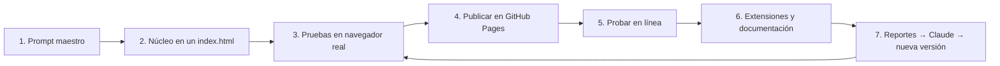

# PROMPT.md — Cómo replicar DjClaudeBrave con Claude

🇪🇸 **Español** · 🇬🇧 [English prompt](#-master-prompt-english)

Este documento reúne todo lo aprendido al construir DjClaudeBrave para que **cualquier persona pueda replicarlo con Claude** en una tarde. Trae las herramientas, el prompt maestro, el flujo por fases y los errores que ya resolvimos, para no repetirlos.

> El proyecto original nació de un prompt de unos 20 minutos de diseño y se construyó en varias sesiones con Claude. Este prompt condensa esas decisiones en un solo texto.

---

## 🧰 Herramientas necesarias

| Herramienta | Para qué | ¿Obligatoria? |
|---|---|---|
| **Claude** con ejecución de código (Claude Code, o Claude en claude.ai con acceso a archivos) | Diseñar, escribir, probar y documentar | Sí |
| **Cuenta de GitHub** | Guardar el código y publicarlo | Sí |
| **GitHub Pages** | Publicar la app gratis (`https://TU_USUARIO.github.io/TU_REPO/`) | Sí, YouTube no reproduce en `file://` |
| **Navegador moderno** (Brave, Chrome, Safari, Firefox) | Usar y probar la app | Sí |
| **VS Code** + extensión **Live Server** | Editar y probar en local con origen web | Recomendada |
| **Claude in Chrome** o conexión de GitHub en Claude | Que Claude suba los archivos por ti | Opcional |
| **Clave de YouTube Data API** | Búsqueda más estable que los servicios comunitarios | Opcional |

**No se necesita:** Node, npm, frameworks, servidores propios ni bases de datos.

---

## 🔁 Flujo de trabajo



| Fase | Qué se hace | Punto de control antes de seguir |
|:---:|---|---|
| 1 | Pegar el prompt maestro | Claude confirma el plan y los límites técnicos |
| 2 | Construir el núcleo en un solo `index.html` | Abre sin errores en la consola |
| 3 | Probar en un navegador real (servidor local, no `file://`) | Dos decks suenan y la mezcla A → B completa |
| 4 | Crear el repo y activar GitHub Pages (`main` / raíz) | El enlace público carga la app |
| 5 | Probar desde el enlace público en celular y computador | Sin desplazamiento horizontal a 320 px; la mezcla funciona |
| 6 | Plugins, reporte con diagnóstico, README bilingüe, CLAUDE.md | Los enlaces internos de la documentación funcionan |
| 7 | Cada reporte se resuelve con Claude siguiendo CLAUDE.md | Versión y CHANGELOG actualizados |

---

## 🎯 Prompt maestro (español)

Copia todo el bloque, reemplaza lo que está entre `[CORCHETES]` y pégalo en Claude.

````text
Actúa como desarrollador web senior y diseñador de producto. Vamos a construir juntos
«[NOMBRE DEL PROYECTO]», un mezclador DJ de YouTube que corre completo en el navegador,
inspirado en Winamp, VirtualDJ, Mixxx y las controladoras tipo Reloop.

## Problema que resuelve
Con YouTube en una pestaña, buscar la siguiente canción corta la que suena. La app separa
lo que suena (deck en vivo) de lo que se prepara (el otro deck, la búsqueda y la lista).

## Público y espíritu (categoría «Family Open»)
- Para toda la familia, incluidos niños: textos simples en [IDIOMA], sin jerga.
- Gratis siempre, código abierto (MIT), sin cuentas, sin anuncios, sin rastreo ni analítica.
- Lo que se guarda, se guarda solo en el navegador (localStorage dentro de try/catch).

## Reglas técnicas que no se rompen
1. Plug and play: TODO el núcleo en un solo index.html (HTML + CSS + JS en línea).
   Sin Node, npm, frameworks ni build. No uses módulos ES en archivos separados:
   el navegador los bloquea al abrir como file://.
2. Se publica en GitHub Pages. Explica que YouTube NO reproduce en páginas file://
   (error 153) y muestra un aviso en la app si se abre así.
3. Funciones nuevas no esenciales van como plugins en plugins/*.js. Si un plugin falla
   o falta, el núcleo sigue funcionando.
4. Responsivo desde 320 px, táctil y con teclado. En celular, crossfader y botón
   «Mezclar» en una barra fija inferior.
5. Respeta a los dueños de derechos: si un video solo se permite en youtube.com, NO
   extraigas su audio por otra vía. Busca otra versión permitida o ofrece abrirlo en YouTube.
6. Nada de logos de marcas de terceros dibujados por ti. [Si tienes tu propia
   ilustración, indica aquí que la usarás.]
7. Nunca guardes claves en el repositorio.

## Límites honestos que debes explicar y respetar
- El audio de YouTube vive en un iframe de otro origen: no hay EQ ni filtros; la mezcla
  es por volumen.
- El reproductor embebido solo acepta pasos de tempo de 0,25×: usa los valores que
  devuelve getAvailablePlaybackRates() y ofrece «Nudge» para cuadrar golpes.
- Spotify y Apple Music no sirven: DRM y términos de uso.
- Algunos videos bloquean la reproducción embebida (errores 101/150/152) y otros no
  arrancan sin avisar: detéctalo con un temporizador.

## Funciones del núcleo
- Dos decks (A ámbar, B azul) con YouTube IFrame API: play/pausa, CUE estilo CDJ,
  4 hot cues, saltos de 4 tiempos, barra de posición, tempo, Tap BPM, Sync y Nudge.
- Cada video dentro de un marco con look de cassette translúcido, dibujado solo con CSS:
  etiqueta manuscrita con el título, carretes que giran según el tempo y cinta que pasa
  de un carrete al otro según el avance.
- Crossfader con curvas (potencia constante, lineal, corte), master y ganancia por deck.
  Usa setInterval (no requestAnimationFrame) para que la mezcla siga con la pestaña
  en segundo plano.
- Botón «Mezclar» que espera a que el deck entrante suene de verdad antes de abrir
  el crossfader.
- Búsqueda sin clave con instancias públicas de Piped e Invidious, con respaldo
  automático entre varias; clave opcional de YouTube Data API.
- Arrastrar y soltar enlaces desde otra pestaña a un deck o a la lista.
- Lista de reproducción persistente: NO se borra al sonar. Marca con ✓ lo que sonó en
  cualquier deck, resalta la siguiente, «Sonando A/B», repetir, volver al inicio,
  guardar y abrir archivo JSON, y vaciar con confirmación. Cada entrada lleva un uid
  propio para que una canción repetida no se confunda.
- Auto‑DJ: precarga la siguiente de la lista en el deck libre y la mezcla al final.
- Versiones alternativas: si un video está bloqueado, busca el mismo tema en versión
  «lyrics/letra/audio», prueba cada candidato en un reproductor oculto y silenciado,
  y carga el primero que funcione. Si no sabe el título, se lo pregunta al usuario.
- Bus de eventos (track:load, deck:play, deck:pause, deck:end, deck:error,
  deck:alternative, mix:start, mix:end) y API de plugins:
  window.[NOMBRE].use({ name, setup(api) }), con un plugin de ejemplo
  «Historial de la sesión».
- Botón «Reportar un problema» que abre un issue de GitHub con un diagnóstico
  automático (versión, navegador, pantalla, estado de los decks, errores recientes;
  nunca la clave).
- Atajos de teclado que siguen funcionando aunque se haga clic sobre el video
  (pon una capa transparente encima del iframe).

## Diseño
Consola oscura de grafito, deck A en ámbar y deck B en azul, tipografía condensada.
Evita plantillas genéricas. Respeta prefers-reduced-motion.

## Documentación del repositorio
README.md en [IDIOMA] y README.en.md en inglés, con selector de idioma; ARCHITECTURE.md
(módulos, eventos, API, restricciones); CLAUDE.md (reglas para que Claude resuelva
reportes); CONTRIBUTING.md; CHANGELOG.md; plantillas de issues; etiquetas Open Graph
e imagen para compartir.
Incluye en el README: la historia de cómo nació, los datos del autor
([NOMBRE, ROL, ENLACES]) y una sección «Invítame un café, si lo deseas» con
[ENLACE O CORREO DE PAYPAL].

## Cómo quiero que trabajes
1. Antes de programar, resume el plan y los límites técnicos en pocas líneas.
2. Construye por fases: núcleo → pruebas → publicar → extensiones → documentación.
3. Prueba de verdad en un navegador (por ejemplo Playwright con un servidor local),
   no solo la sintaxis: dos decks sonando, mezcla completa, sin errores en consola,
   sin desplazamiento horizontal en 320, 375, 768 y 1440 px.
4. Si algo no se puede hacer por una regla de la plataforma, dilo claro y ofrece
   la mejor alternativa permitida.
5. Cada entrega: qué cambió, cómo lo probaste y qué queda pendiente. Sube la versión
   y anota el CHANGELOG.
````

---

## 🪜 Prompts de seguimiento por fase

Úsalos después del prompt maestro, uno por mensaje, revisando cada resultado antes de seguir.

| Fase | Prompt corto |
|:---:|---|
| 2 | «Construye el núcleo completo en un solo index.html y pruébalo en un navegador con un servidor local. Muéstrame capturas en 375 y 1440 px.» |
| 3 | «Prueba la mezcla real: carga un video en A y otro en B, reproduce A, mezcla a B y confirma que el crossfader llega a B y A se pausa.» |
| 4 | «Crea el repositorio [USUARIO]/[REPO], sube los archivos y activa GitHub Pages desde main / raíz. Verifica que el enlace público carga la app.» |
| 5 | «Revisa la app publicada en celular y escritorio. Corrige desbordes, botones de menos de 36 px y textos cortados.» |
| 6 | «Agrega la API de plugins con el plugin de historial, el botón de reporte con diagnóstico, CLAUDE.md, ARCHITECTURE.md, CONTRIBUTING.md, CHANGELOG.md y plantillas de issues.» |
| 6 | «Escribe el README en español e inglés con selector de idioma, historia del proyecto, autor, invítame un café, proyectos open source relacionados e imagen para compartir.» |
| 7 | «Lee el issue #N de [USUARIO]/[REPO] y resuélvelo siguiendo CLAUDE.md. Prueba, sube la versión y anota el CHANGELOG.» |

---

## 🧠 Lecciones aprendidas (para no repetir errores)

| Síntoma | Causa | Solución aplicada |
|---|---|---|
| Al abrir `index.html` con doble clic, «Buscar» no hace nada | El navegador bloquea los módulos JS separados en `file://` | Todo el JavaScript en línea dentro de `index.html` |
| «Error 153» de YouTube | YouTube no reproduce en páginas `file://` | Publicar en GitHub Pages; aviso dentro de la app |
| El tempo 1,03× no cambia nada | El reproductor embebido solo acepta pasos de 0,25× | Slider con los valores reales del reproductor + Nudge |
| «Video no disponible: el autor no permite reproducirlo fuera de YouTube» | Decisión del dueño de los derechos | Buscar otra versión permitida, probarla oculta y cargarla; nunca esquivar el bloqueo |
| Algunos videos se quedan cargando sin error | YouTube no siempre avisa | Temporizador de 7 s que marca el deck como fallido |
| La mezcla entra a silencio | Se abría el crossfader antes de que el deck sonara | Esperar el estado «reproduciendo» antes de mezclar |
| Tras un error, el deck no vuelve a sonar | `playVideo()` falla en estados -1/5 | Usar `loadVideoById()` en esos estados |
| Los atajos dejan de funcionar al hacer clic en el video | El foco queda dentro del iframe | Capa transparente encima del video |
| La mezcla se detiene con la pestaña en segundo plano | `requestAnimationFrame` se pausa | `setInterval` para la transición |
| El aviso rojo aparece en todos los decks | Una regla CSS más específica le ganaba al estado oculto | Selectores precisos (`> [data-el="player"]`) |
| La lista marca mal cuando una canción está repetida | Se identificaba por el ID de YouTube | Cada entrada con su propio `uid` |
| La subida a GitHub por la web queda a medias | Archivos grandes en una sola tanda | Subir por carpetas y verificar con hash (SHA‑256) |

---

## ✅ Lista de verificación final

- [ ] La consola del navegador no muestra errores.
- [ ] Dos decks suenan; «Mezclar» lleva el crossfader de A a B y pausa A.
- [ ] La búsqueda devuelve resultados sin clave.
- [ ] Un video bloqueado se reemplaza solo por una versión permitida (o se ofrece «Abrir en YouTube»).
- [ ] La lista de reproducción sobrevive a recargar la página y no se borra al sonar.
- [ ] Sin desplazamiento horizontal en 320, 375, 414, 768, 1024 y 1440 px.
- [ ] La app funciona aunque falte `plugins/historial.js`.
- [ ] «Reportar un problema» abre un issue con diagnóstico y sin claves.
- [ ] El enlace de GitHub Pages carga la última versión.
- [ ] README en ambos idiomas, con autor y «Invítame un café».

---

## 🇬🇧 Master prompt (English)

<details>
<summary><strong>Show the English version of the master prompt</strong></summary>

````text
Act as a senior web developer and product designer. Together we'll build
"[PROJECT NAME]", a YouTube DJ mixer that runs entirely in the browser, inspired by
Winamp, VirtualDJ, Mixxx and Reloop-style controllers.

## Problem it solves
With YouTube in one tab, searching for the next song stops the one playing. The app
separates what's playing (live deck) from what's being prepared (the other deck,
search and playlist).

## Audience and spirit ("Family Open" category)
- For the whole family, kids included: simple text in [LANGUAGE], no jargon.
- Always free, open source (MIT), no accounts, no ads, no tracking or analytics.
- Anything saved stays in the browser only (localStorage wrapped in try/catch).

## Technical rules that never break
1. Plug and play: the WHOLE core in a single index.html (inline HTML + CSS + JS).
   No Node, npm, frameworks or build step. Don't use separate ES module files:
   browsers block them when opened as file://.
2. Hosted on GitHub Pages. Explain that YouTube does NOT play on file:// pages
   (error 153) and show a notice in the app when opened that way.
3. Non-essential features go in plugins/*.js. If a plugin fails or is missing,
   the core keeps working.
4. Responsive from 320 px, touch and keyboard friendly. On phones, crossfader and
   "Mix" button in a fixed bottom bar.
5. Respect rights holders: if a video is only allowed on youtube.com, do NOT extract
   its audio another way. Find another allowed version or offer to open it on YouTube.
6. Don't draw third-party brand logos. [If you have your own artwork, say so here.]
7. Never commit keys to the repository.

## Honest limits you must explain and respect
- YouTube audio lives in a cross-origin iframe: no EQ or filters; mixing is by volume.
- The embedded player only accepts 0.25× tempo steps: use the values from
  getAvailablePlaybackRates() and offer "Nudge" to line up beats.
- Spotify and Apple Music can't be used: DRM and terms of use.
- Some videos block embedded playback (errors 101/150/152) and others silently never
  start: detect it with a timer.

## Core features
- Two decks (A amber, B blue) using the YouTube IFrame API: play/pause, CDJ-style CUE,
  4 hot cues, 4-beat jumps, seek bar, tempo, Tap BPM, Sync and Nudge.
- Each video inside a translucent cassette-style frame drawn with CSS only:
  handwritten label with the title, reels spinning with the tempo, and tape moving
  from one reel to the other as the song plays.
- Crossfader with curves (constant power, linear, cut), master and per-deck gain.
  Use setInterval (not requestAnimationFrame) so mixes continue in a background tab.
- "Mix" button that waits until the incoming deck is really playing before opening
  the crossfader.
- Keyless search via public Piped and Invidious instances with automatic fallback;
  optional YouTube Data API key.
- Drag and drop links from another tab onto a deck or the playlist.
- Persistent playlist: NOT removed after playing. Ticks ✓ what played on either deck,
  highlights the next one, "Playing A/B", loop, restart, save/open JSON file, and
  clear with confirmation. Each entry has its own uid so repeated songs don't clash.
- Auto-DJ: preloads the next playlist song on the free deck and mixes it at the end.
- Alternative versions: if a video is blocked, search the same song as
  "lyrics/audio", test each candidate in a hidden muted player and load the first
  that works. If the title is unknown, ask the user.
- Event bus (track:load, deck:play, deck:pause, deck:end, deck:error,
  deck:alternative, mix:start, mix:end) and plugin API:
  window.[NAME].use({ name, setup(api) }), with a sample "Session history" plugin.
- "Report a problem" button that opens a GitHub issue with automatic diagnostics
  (version, browser, screen, deck state, recent errors; never the key).
- Keyboard shortcuts that keep working after clicking the video (put a transparent
  layer over the iframe).

## Design
Dark graphite console, deck A in amber and deck B in blue, condensed typography.
Avoid generic templates. Respect prefers-reduced-motion.

## Repository documentation
README in [LANGUAGE] plus README.en.md in English with a language switch;
ARCHITECTURE.md (modules, events, API, constraints); CLAUDE.md (rules so Claude can
fix reports); CONTRIBUTING.md; CHANGELOG.md; issue templates; Open Graph tags and
a share image. In the README include how it started, the author's details
([NAME, ROLE, LINKS]) and a "Buy me a coffee, if you'd like" section with
[PAYPAL LINK OR EMAIL].

## How I want you to work
1. Before coding, summarize the plan and technical limits in a few lines.
2. Build in phases: core → tests → publish → extensions → documentation.
3. Test for real in a browser (e.g. Playwright with a local server), not just
   syntax: two decks playing, a full mix, no console errors, no horizontal scroll at
   320, 375, 768 and 1440 px.
4. If something can't be done because of a platform rule, say so clearly and offer
   the best allowed alternative.
5. Each delivery: what changed, how you tested it and what's pending. Bump the
   version and update the CHANGELOG.
````

</details>

---

Hecho con 💛 para Sofía, Iván y Máximo, y para todas las familias. · MIT © Claudio Abarca Vargas · Family Open 🇨🇱
