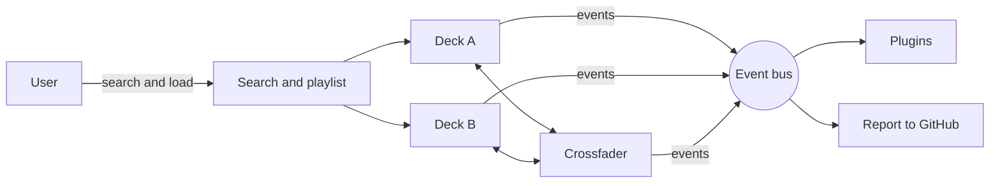

<div align="center">

🇪🇸 [Español](README.md) · 🇬🇧 **English**

<a href="https://csav20.github.io/DjClaudeBrave/"></a>

<h1>DjClaudeBrave</h1>

<a href="https://csav20.github.io/DjClaudeBrave/"></a>

[](https://csav20.github.io/DjClaudeBrave/)
[](#-family-open)
[](LICENSE)
[](ARCHITECTURE.md)
[](index.html)
[](#-thanks)
[](https://www.paypal.com/donate/?business=csav20%40gmail.com&item_name=Buy+me+a+coffee+-+DjClaudeBrave&currency_code=USD)

</div>

> **DjClaudeBrave** is a free DJ mixer that runs in your browser: two cassette‑style YouTube decks, a crossfader, a saved playlist and Auto‑DJ, with **zero gaps and nothing to install**. A **Family Open** project, so every family can have real DJ tools at hand.
>
> 🇪🇸 *Un mezclador DJ gratis que corre en tu navegador, para toda la familia. [Leer en español →](README.md)*

> ℹ️ The app interface is in Spanish for now; an English interface is on the roadmap. Icons, colors and the A/B layout make it easy to use either way.

---

## 💛 For Sofía, Iván and Máximo

This project was born with my children in mind: **Sofía, Iván and Máximo**.

I wanted them to be able to play their music, mix it and liven up a family afternoon with a real tool, **just like any DJ would have**, without paying for licenses, installing software or relying on expensive gear. Just open a link.

And I wanted something more: for it not to be only theirs. For **every child, every family and every person** to have the same tools within reach. That's why DjClaudeBrave is, and will stay, **Family Open**: free, open and made to be shared.

---

## 🌱 How it started

It all began with an everyday annoyance: with YouTube open in **Brave**, every time I searched for the next song, **the one playing would stop**.

| Moment | What happened |
|---|---|
| 💭 **The idea** | One Sunday in October 2026, playing music with the family, the song cut off once again. Then the question came up: *what if the browser were a DJ booth?* |
| ✍️ **The prompt** | Designing and writing the prompt for Claude took **about 20 continuous minutes**. In it I made the case through historic programs (Winamp, VirtualDJ, Mixxx and the old online mixers), legacy architectures and the **plug and play** idea, why Spotify and Apple Music can't be used for mixing, how to run YouTube inside Brave, and the feel of a Reloop‑style controller. |
| 🤝 **The build** | In **a single afternoon, about two and a half hours** of continuous work with Claude, the project went through several versions: from a first test to a published, responsive app with plugins, ready to grow. |
| 🎧 **Today** | **DjClaudeBrave**, category **Family Open**: open, free, in Spanish and English, and ready for anyone to improve. |

<details>
<summary><strong>📜 See the versions from that afternoon</strong></summary>

| Version | What was added |
|---|---|
| 0.1 | Two YouTube decks, crossfader, queue, Auto‑DJ and keyboard shortcuts |
| 0.1.1 | Tempo within YouTube's limits, Nudge and blocked‑video detection |
| 0.2 | Everything in a single `index.html`, keyless search and GitHub Pages hosting |
| 0.2 → | Final name: **DjClaudeBrave** |
| 0.3 | First DJ logo with an animated turntable and a mobile layout |
| 0.4 | Plug and play architecture, session history and report button |
| 0.4.1 | Bilingual presentation, animated banner and share image |
| 0.5 | Automatic alternative versions for videos blocked outside YouTube |
| 0.5.1 | Official project artwork: the DJ with headphones and his record |
| 0.6 | Translucent cassette‑style decks and a saved playlist that is not removed after playing |

Full details in [CHANGELOG.md](CHANGELOG.md).

</details>

---

## 🕰️ From Winamp to DjClaudeBrave

DjClaudeBrave stands on three decades of music software. It takes one idea from each era:

| Approx. year | Software | What it brought | What DjClaudeBrave takes |
|:---:|---|---|---|
| 1997 | **Winamp** | Digital music on any PC, playlists and skins | The play queue and the "take it anywhere" spirit |
| 2000 | **Traktor** | Professional digital DJing | Independent, synced decks |
| 2001 | **Mixxx** | Free, open source DJing | The open philosophy and the local‑deck roadmap |
| 2003 | **VirtualDJ** | Mixing from the home computer | Two decks, a crossfader and Auto‑DJ |
| 2005 | **YouTube** | A huge catalog one click away | The music catalog |
| 2008 · 2015 | **Spotify · Apple Music** | Streaming everywhere | The lesson: with DRM you can't mix in third‑party apps |
| 2016 | **Brave** | A fast, private browser | The platform: everything runs in one tab |
| 2018 | **Webamp** | Winamp rebuilt in the browser | Proof that the browser is enough |
| **2026** | **DjClaudeBrave** | **All of it together, plug and play, Family Open** | — |

> **Why not Spotify or Apple Music?** Their content is DRM‑protected and their developer terms don't allow mixing it in third‑party apps. YouTube, on the other hand, offers an official embedded player that a web page can control.

---

## ▶️ Use it now

<div align="center">

### 👉 **[csav20.github.io/DjClaudeBrave](https://csav20.github.io/DjClaudeBrave/)**

</div>

| Step | What to do |
|---|---|
| 1️⃣ | Open the link in Brave, Chrome, Safari or Firefox (computer, tablet or phone) |
| 2️⃣ | Search for a song (*Buscar*) and press **A** to load it on deck A; press ▶ |
| 3️⃣ | Find the next one and load it on deck **B** while the first keeps playing |
| 4️⃣ | Press **Mezclar** (Mix) or move the crossfader, and the music flows from A to B with no gap |
| 5️⃣ | Long party? Build your **Lista de reproducción** (playlist) with «+ Lista» and turn on **Auto‑DJ**: it mixes on its own, song after song, and the list stays saved for next time |

> ⚠️ Always open it from the link. If you double‑click `index.html` on your computer, YouTube blocks playback (error 153).

---

## ✨ Features

| Area | What's included |
|---|---|
| 📼 **Cassette look** | Each video plays inside a translucent cassette: a handwritten label with the song, screws, and reels that spin with the tempo; the tape moves from one reel to the other as the song plays |
| 💿 **Two decks** | Play/pause, CDJ‑style CUE, 4 hot cues per deck, 4‑beat jumps, seek bar |
| 🎚️ **Mixer** | Crossfader with 3 curves (smooth, linear, scratch), master, per‑deck gain, automatic mixes from 2 to 40 s |
| 🥁 **Tempo** | Per‑deck tempo, **Tap BPM**, **Sync** and **Nudge ±** to line up the beats |
| 📜 **Playlist** | Saved in your browser and **not removed after playing**: ticks ✓ whatever played on either deck, highlights the next one, and can loop, restart, be saved to a file and reopened |
| 🤖 **Auto‑DJ** | Preloads the next song from the playlist and mixes it at the end of each track |
| 🔎 **Search** | Built in, no API key (Piped / Invidious, open source); you can also drag links from another tab |
| 🔁 **Blocked videos** | If a video's owner only allows it on youtube.com, the app automatically finds another version of the song (lyrics, audio) that can play here, or opens it on YouTube |
| 📱 **Responsive** | On phones, the crossfader and Mix button live in a fixed bottom bar, always within reach |
| 📝 **History** | Logs every song in the session and copies the list in one click (bundled plugin) |
| 🐞 **Report** | One button opens a GitHub report with diagnostics already filled in |
| ⌨️ **Keyboard** | `Q`/`O` play, `W`/`P` cue, `1–4` / `7–0` hot cues, `←` `→` crossfader, `Space` mix |

---

## 👨‍👩‍👧‍👦 Family Open

DjClaudeBrave **was born, and will stay**, in the **Family Open** category:

| Principle | Commitment |
|---|---|
| 🆓 **Always free** | No paid plans, no locked features |
| 🔓 **Open** | Free code under the MIT license: use it, study it, improve it and share it |
| 👨‍👩‍👧 **For the whole family** | Simple to use, no accounts or sign‑ups, no ads of its own |
| 🔒 **Respects your privacy** | DjClaudeBrave collects no data: your playlist and settings stay in your browser |
| 🔌 **Plug and play** | Open a link and it works: nothing to install, build or configure |
| 🌍 **Bilingual** | Presentation in Spanish and English |
| 🌱 **Grows with everyone** | Anyone can report issues, suggest ideas or write a plugin |

> ℹ️ The music comes from YouTube and search uses community services; each has its own policies. As with YouTube, help little ones pick their songs.

---

## 🏗️ Plug and play architecture

DjClaudeBrave has a **core** in a single file and **optional extensions** that plug in without touching it:

```
index.html     →  full core (decks, mixer, search, playlist, Auto‑DJ)
plugins/*.js   →  optional extensions (if one fails, the core keeps working)
assets/        →  artwork, logo, favicon and share image
```



| Document | What it's for |
|---|---|
| [ARCHITECTURE.md](ARCHITECTURE.md) | Modules, events, plugin API and technical constraints *(Spanish)* |
| [plugins/README.md](plugins/README.md) | Create a plugin in 3 steps, with a template *(Spanish)* |
| [CONTRIBUTING.md](CONTRIBUTING.md) | How to report, suggest and contribute; Family Open rules *(Spanish)* |
| [CLAUDE.md](CLAUDE.md) | Context and rules for Claude to work on the project *(Spanish)* |
| [CHANGELOG.md](CHANGELOG.md) | Version history *(Spanish)* |

---

## 🌱 Grow with Claude

DjClaudeBrave is set up to improve with every person who uses it:

| Step | What happens |
|---|---|
| 1️⃣ **You use the app** | At a party, a class or at home |
| 2️⃣ **You report** | The **Reportar un problema** (Report an issue) button opens a GitHub issue with version, browser, deck state and errors |
| 3️⃣ **Claude fixes it** | With [CLAUDE.md](CLAUDE.md), Claude learns the project rules, reproduces the problem, fixes it and tests it |
| 4️⃣ **It goes live** | A push to `main` and GitHub Pages publishes it in 1–2 minutes |

For example, with Claude Code: *"Read issue #12 in Csav20/DjClaudeBrave and fix it following CLAUDE.md."* Always review the change before publishing.

---

## 🔭 Related open source projects

DjClaudeBrave doesn't start from scratch. These open projects inspire it or make it possible, and are good candidates for future integrations:

| Project | What it is | How it relates to DjClaudeBrave |
|---|---|---|
| [Mixxx](https://github.com/mixxxdj/mixxx) | Free desktop DJ software | Feature reference for the future local deck with EQ and auto BPM |
| [Webamp](https://github.com/captbaritone/webamp) | Winamp 2 rebuilt in the browser | Inspiration: the browser can be a full player |
| [Piped](https://github.com/TeamPiped/Piped) | Free front end for YouTube | Source of keyless search |
| [Invidious](https://github.com/iv-org/invidious) | Free front end for YouTube | Backup search source |
| [wavesurfer.js](https://github.com/katspaugh/wavesurfer.js) | Audio waveforms on the web | Candidate for drawing the local deck's waveform |

Know another project that belongs here? Suggest it in an [issue](https://github.com/Csav20/DjClaudeBrave/issues/new/choose).

---

## 🛠 For developers

The core is **a single file: [`index.html`](index.html)** (HTML + CSS + JavaScript), with no Node, npm or dependencies. Inside the `<script>`, the code is organized into modules: `ui`, `youtube`, `search`, `deck`, `mixer`, `library` and `app`.

```bash
git clone https://github.com/Csav20/DjClaudeBrave.git
cd DjClaudeBrave
python3 -m http.server 5173   # open http://localhost:5173
code .                        # edit in VS Code
git push                      # GitHub Pages updates in 1–2 minutes
```

### Honest limits

- **No EQ or filters on YouTube:** the browser can't process the audio of an embedded video; mixing is by volume.
- **Tempo in 0.25× steps:** that's what YouTube's embedded player allows; use Nudge to line up beats.
- **Some videos can only be watched on youtube.com.** That's the rights holder's choice (for example, music publishers such as UMPG), not Brave's or the app's. DjClaudeBrave **doesn't work around that block**: it automatically searches for another version of the same song that is allowed to play, tests each candidate in a hidden, muted player, and loads the first one that works. If none does, the **Abrir en YouTube** (Open on YouTube) button opens the original in a separate window (that audio stays outside the crossfader).
- **Spotify and Apple Music** aren't integrated: their content is DRM‑protected and their terms don't allow mixing.

### 🗺️ Roadmap

| Status | Milestone |
|---|---|
| ✅ | Two YouTube decks, crossfader, queue and Auto‑DJ |
| ✅ | A single `index.html`, hosted on GitHub Pages and responsive |
| ✅ | Plugin architecture, session history and diagnostic reports |
| ✅ | Bilingual Spanish / English presentation |
| ✅ | Cassette‑style decks and a persistent playlist |
| ✅ | Automatic playable alternatives for blocked videos |
| 🔜 | Local file deck with 3‑band EQ, filter, waveform and auto BPM |
| 🔜 | Physical DJ controllers via Web MIDI (Reloop, Pioneer DDJ, Numark) |
| 🔜 | Kids mode: big buttons and only the essentials, designed for Sofía, Iván and Máximo |
| 🔜 | App interface in English too |
| 🎯 | Session recording |

---

## 📣 Share it

Like it? Share it with other families, teachers and friends. When you paste the link, a card with the DJ artwork and the project name shows up.

<div align="center">

[](https://wa.me/?text=%F0%9F%8E%A7%20DjClaudeBrave%3A%20a%20free%20DJ%20mixer%20in%20your%20browser%2C%20for%20the%20whole%20family%20https%3A//csav20.github.io/DjClaudeBrave/)
[](https://twitter.com/intent/tweet?text=%F0%9F%8E%A7%20DjClaudeBrave%3A%20a%20free%20DJ%20mixer%20in%20your%20browser%2C%20for%20the%20whole%20family&url=https%3A%2F%2Fcsav20.github.io%2FDjClaudeBrave%2F)
[](https://www.facebook.com/sharer/sharer.php?u=https%3A%2F%2Fcsav20.github.io%2FDjClaudeBrave%2F)
[](https://www.linkedin.com/sharing/share-offsite/?url=https%3A%2F%2Fcsav20.github.io%2FDjClaudeBrave%2F)
[](https://t.me/share/url?url=https%3A%2F%2Fcsav20.github.io%2FDjClaudeBrave%2F&text=%F0%9F%8E%A7%20DjClaudeBrave%3A%20a%20free%20DJ%20mixer%20in%20your%20browser%2C%20for%20the%20whole%20family)


</div>

---

## 👨‍🔬 Author

<table>
  <tr>
    <td>🧑‍🔬</td>
    <td><strong>Dr. Claudio Abarca Vargas</strong></td>
    <td>PhD in Human Motor Sciences</td>
  </tr>
  <tr>
    <td>🏟️</td>
    <td><strong>High Performance Center of Chile (CAR)</strong></td>
    <td>Physiology Lab · Sports Innovation Lab</td>
  </tr>
  <tr>
    <td>🧪</td>
    <td><strong>ACTIONSMART® Research Lab</strong></td>
    <td>Technology, physiology and artificial intelligence</td>
  </tr>
  <tr>
    <td>🫁</td>
    <td><strong>Inventor of VO2Smart PRO</strong></td>
    <td>Portable CPET platform · Patent CL 2024024875</td>
  </tr>
  <tr>
    <td>🩸</td>
    <td><strong>Founder of BFR Chile</strong></td>
    <td>Since 2010</td>
  </tr>
</table>

DjClaudeBrave follows the same thread as all my work: **democratizing access to technology**. Just as VO2Smart PRO brings the physiology lab to those who need it, DjClaudeBrave brings the DJ experience to any family.

---

## ☕ Buy me a coffee

DjClaudeBrave is and will always be free. If it helped you liven up a party, a class or a family afternoon, and **if you'd like to**, you can buy me a coffee through my PayPal account. Every coffee helps me keep building open tools for everyone.

<div align="center">

[](https://www.paypal.com/donate/?business=csav20%40gmail.com&item_name=Buy+me+a+coffee+-+DjClaudeBrave&currency_code=USD)

**PayPal account:** `csav20@gmail.com`

</div>

| Other ways to support | How |
|---|---|
| ⭐ **A star** | Star the repository at the top right |
| 📣 **Share it** | Use the buttons in [Share it](#-share-it) |
| 🐞 **Report** | Every report makes the app better for everyone |
| 🧩 **A plugin** | Build an extension and share it |

Any support is voluntary and hugely appreciated.

---

## 🙏 Thanks

DjClaudeBrave was built together with **Claude**, Anthropic's AI assistant: from the idea and the code to the testing, the GitHub Pages launch and this presentation. *Thank you so much, Claude!*

Thanks as well to the open source projects that make it possible, listed under [Related projects](#-related-open-source-projects).

> Claude, Anthropic, Brave, YouTube, Spotify, Apple Music, Winamp, VirtualDJ and Traktor are trademarks of their respective owners. DjClaudeBrave is an independent personal project, not affiliated with or endorsed by those companies.

---

## 📫 Contact

<div align="center">

[](mailto:csav20@gmail.com)
[](https://www.linkedin.com/in/pabarca/)
[](https://github.com/Csav20)
[](https://github.com/Csav20)

</div>

---

<div align="center">


*"Music shared as a family should never be cut short."*

Made with 💛 for Sofía, Iván and Máximo, and for every family.

**MIT © Claudio Abarca Vargas** · Family Open 🇨🇱

</div>
