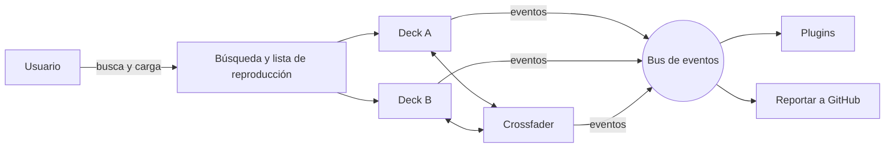
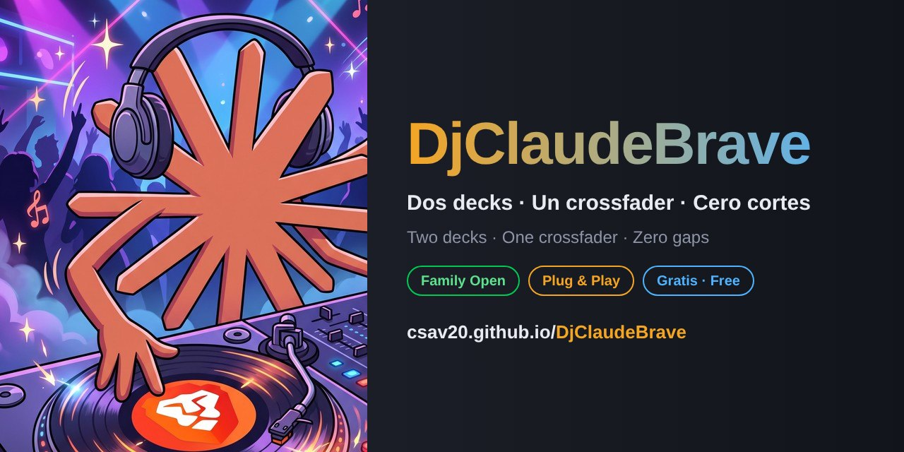

<div align="center">

🇪🇸 **Español** · 🇬🇧 [English](README.en.md)

<a href="https://csav20.github.io/DjClaudeBrave/"></a>

<h1>DjClaudeBrave</h1>

<a href="https://csav20.github.io/DjClaudeBrave/"></a>

[](https://csav20.github.io/DjClaudeBrave/)
[](#-family-open)
[](LICENSE)
[](ARCHITECTURE.md)
[](index.html)
[](#-agradecimientos)
[](https://www.paypal.com/donate/?business=csav20%40gmail.com&item_name=Inv%C3%ADtame+un+caf%C3%A9+-+DjClaudeBrave&currency_code=USD)

</div>

> **DjClaudeBrave** es un mezclador DJ gratis que corre en tu navegador: dos decks de YouTube con look de cassette, crossfader, lista de reproducción guardada y Auto‑DJ, **sin cortes y sin instalar nada**. Un proyecto **Family Open**, hecho para que cualquier familia tenga a mano herramientas de DJ de verdad.
>
> 🇬🇧 *A free DJ mixer that runs in your browser: two cassette‑style YouTube decks, a crossfader, a saved playlist and Auto‑DJ, with **zero gaps and nothing to install**. A **Family Open** project, so every family can have real DJ tools at hand. [Read in English →](README.en.md)*

---

## 💛 Para Sofía, Iván y Máximo

Este proyecto nació pensando en mis hijos, **Sofía, Iván y Máximo**.

Quería que pudieran poner su música, mezclarla y animar una tarde en familia con una herramienta de verdad, **como la que tendría cualquier DJ**, sin pagar licencias, sin instalar programas y sin depender de equipos caros. Solo abrir un enlace.

Y quería algo más: que no fuera solo para ellos. Que **cualquier niño, cualquier familia y cualquier persona** tuviera los mismos elementos a su alcance. Por eso DjClaudeBrave es y será **Family Open**: gratis, abierto y hecho para compartirse.

---

## 🌱 Cómo nació

Todo partió de un problema muy cotidiano: con YouTube abierto en **Brave**, cada vez que buscaba la siguiente canción, **la que estaba sonando se cortaba**.

| Momento | Qué pasó |
|---|---|
| 💭 **La idea** | Un domingo de octubre de 2026, buscando música en familia, la canción se cortó una vez más. Ahí apareció la pregunta: *¿y si el navegador fuera una mesa de DJ?* |
| ✍️ **El prompt** | Diseñar y escribir el prompt para Claude tomó **unos 20 minutos continuos**. En él argumenté los programas históricos (Winamp, VirtualDJ, Mixxx y los mezcladores online de antes), las arquitecturas antiguas y la idea de **plug and play**, por qué Spotify y Apple Music no sirven para mezclar, cómo correr YouTube dentro de Brave y la experiencia de una controladora tipo Reloop. |
| 🤝 **La construcción** | En **una sola tarde, unas 2 horas y media** de trabajo continuo con Claude, el proyecto pasó por varias versiones: de la primera prueba a una app publicada, responsiva, con plugins y lista para crecer. |
| 🎧 **Hoy** | **DjClaudeBrave**, categoría **Family Open**: abierto, gratis, en español e inglés, y preparado para que cualquiera lo mejore. |

<details>
<summary><strong>📜 Ver las versiones de esa tarde</strong></summary>

| Versión | Qué se agregó |
|---|---|
| 0.1 | Dos decks de YouTube, crossfader, cola, Auto‑DJ y atajos de teclado |
| 0.1.1 | Tempo según lo que permite YouTube, Nudge y detección de videos bloqueados |
| 0.2 | Todo en un solo `index.html`, búsqueda sin clave y publicación en GitHub Pages |
| 0.2 → | Nombre definitivo: **DjClaudeBrave** |
| 0.3 | Primer logo del DJ con tornamesa animada y diseño para celular |
| 0.4 | Arquitectura plug and play, historial de la sesión y botón de reporte |
| 0.4.1 | Presentación bilingüe, banner animado e imagen para compartir |
| 0.5 | Versiones alternativas automáticas para videos bloqueados fuera de YouTube |
| 0.5.1 | Ilustración oficial del proyecto: el DJ con audífonos y su vinilo |
| 0.6 | Decks con look de cassette translúcido y lista de reproducción guardada que no se borra al sonar |

Detalle completo en [CHANGELOG.md](CHANGELOG.md).

</details>

---

## 🕰️ De Winamp a DjClaudeBrave

DjClaudeBrave se apoya en tres décadas de software musical. De cada etapa tomó una idea:

| Año aprox. | Software | Qué trajo | Qué toma DjClaudeBrave |
|:---:|---|---|---|
| 1997 | **Winamp** | Música digital en cualquier PC, listas y skins | La cola de reproducción y el espíritu de «llévalo contigo» |
| 2000 | **Traktor** | DJ digital profesional | La idea de decks independientes y sincronizados |
| 2001 | **Mixxx** | DJ libre y open source | La filosofía abierta y la hoja de ruta del deck local |
| 2003 | **VirtualDJ** | Mezclar desde el computador de la casa | Dos decks, crossfader y Auto‑DJ |
| 2005 | **YouTube** | Un catálogo enorme a un clic | El catálogo musical |
| 2008 · 2015 | **Spotify · Apple Music** | Streaming en todas partes | La lección: con DRM no se puede mezclar en apps de terceros |
| 2016 | **Brave** | Navegador rápido y privado | La plataforma: todo corre en una pestaña |
| 2018 | **Webamp** | Winamp recreado en el navegador | La prueba de que el navegador basta |
| **2026** | **DjClaudeBrave** | **Todo junto, plug and play, Family Open** | — |

> **¿Por qué no Spotify ni Apple Music?** Su contenido está protegido con DRM y sus términos para desarrolladores no permiten mezclarlo en aplicaciones de terceros. YouTube, en cambio, ofrece un reproductor embebido oficial que sí se puede controlar desde una página web.

---

## ▶️ Úsalo ahora

<div align="center">

### 👉 **[csav20.github.io/DjClaudeBrave](https://csav20.github.io/DjClaudeBrave/)**

</div>

| Paso | Qué hacer |
|---|---|
| 1️⃣ | Abre el enlace en Brave, Chrome, Safari o Firefox (computador, tablet o celular) |
| 2️⃣ | Busca una canción y presiona **A** para cargarla en el deck A; presiona ▶ |
| 3️⃣ | Busca la siguiente y cárgala en el deck **B** mientras la primera sigue sonando |
| 4️⃣ | Presiona **Mezclar** (o mueve el crossfader) y la música pasa de A a B sin cortes |
| 5️⃣ | ¿Fiesta larga? Arma tu **Lista de reproducción** con «+ Lista» y activa **Auto‑DJ**: mezcla solo, canción tras canción, y la lista queda guardada para la próxima |

> ⚠️ Ábrelo siempre desde el enlace. Si haces doble clic en `index.html` en tu computador, YouTube bloquea la reproducción (error 153).

---

## ✨ Funciones

| Área | Qué incluye |
|---|---|
| 📼 **Look cassette** | Cada video corre dentro de un cassette translúcido: etiqueta escrita a mano con el tema, tornillos y carretes que giran al ritmo del tempo; la cinta pasa de un carrete al otro según avanza la canción |
| 💿 **Dos decks** | Play/pausa, CUE estilo CDJ, 4 hot cues por deck, saltos de 4 tiempos, barra de posición |
| 🎚️ **Mezclador** | Crossfader con 3 curvas (suave, lineal, scratch), master, ganancia por deck, mezcla automática de 2 a 40 s |
| 🥁 **Tempo** | Tempo por deck, **Tap BPM**, **Sync** y **Nudge ±** para cuadrar los golpes |
| 📜 **Lista de reproducción** | Se guarda en tu navegador y **no se borra al sonar**: marca con ✓ lo que ya sonó en cualquier deck, resalta la siguiente, se puede repetir, reiniciar, guardar como archivo y volver a abrir |
| 🤖 **Auto‑DJ** | Precarga la siguiente canción de la lista y la mezcla sola al final de cada tema |
| 🔎 **Búsqueda** | Integrada y sin clave (Piped / Invidious, open source); también arrastrar enlaces desde otra pestaña |
| 🔁 **Videos bloqueados** | Si el dueño de un video solo lo permite en youtube.com, la app busca sola otra versión del tema (lyrics, letra, audio) que sí se pueda reproducir, o lo abre en YouTube |
| 📱 **Responsivo** | En celular, el crossfader y el botón Mezclar quedan en una barra fija, siempre a mano |
| 📝 **Historial** | Anota cada canción de la sesión y copia la lista con un clic (plugin incluido) |
| 🐞 **Reportar** | Un botón abre un reporte en GitHub con el diagnóstico ya completado |
| ⌨️ **Teclado** | `Q`/`O` play, `W`/`P` cue, `1–4` / `7–0` hot cues, `←` `→` crossfader, `Espacio` mezclar |

---

## 👨‍👩‍👧‍👦 Family Open

DjClaudeBrave **nació y se mantendrá** en la categoría **Family Open**:

| Principio | Compromiso |
|---|---|
| 🆓 **Gratis siempre** | Sin planes de pago, sin funciones bloqueadas |
| 🔓 **Abierto** | Código libre bajo licencia MIT: úsalo, estúdialo, mejóralo y compártelo |
| 👨‍👩‍👧 **Para toda la familia** | Simple de usar, sin cuentas ni registros, sin anuncios propios |
| 🔒 **Respeta tu privacidad** | DjClaudeBrave no recopila datos: tu lista y ajustes se guardan solo en tu navegador |
| 🔌 **Plug and play** | Se abre un enlace y funciona: sin instalar, sin compilar, sin configurar |
| 🌍 **Bilingüe** | Presentación en español e inglés |
| 🌱 **Crece con todos** | Cualquiera puede reportar, proponer ideas o escribir un plugin |

> ℹ️ La música viene de YouTube y la búsqueda usa servicios comunitarios; cada uno aplica sus propias políticas. Como en YouTube, acompaña a los más pequeños al elegir canciones.

---

## 🏗️ Arquitectura plug and play

DjClaudeBrave tiene un **núcleo** en un solo archivo y **extensiones opcionales** que se enchufan sin tocarlo:

```
index.html     →  núcleo completo (decks, mezclador, búsqueda, lista de reproducción, Auto‑DJ)
plugins/*.js   →  extensiones opcionales (si una falla, el núcleo sigue funcionando)
assets/        →  ilustración, logo, favicon e imagen para compartir
```



| Documento | Para qué sirve |
|---|---|
| [ARCHITECTURE.md](ARCHITECTURE.md) | Módulos, eventos, API de plugins y restricciones técnicas |
| [plugins/README.md](plugins/README.md) | Cómo crear un plugin en 3 pasos, con plantilla |
| [CONTRIBUTING.md](CONTRIBUTING.md) | Cómo reportar, proponer y contribuir; reglas Family Open |
| [CLAUDE.md](CLAUDE.md) | Contexto y reglas para que Claude trabaje en el proyecto |
| [PROMPT.md](PROMPT.md) | **Replica el proyecto:** prompt maestro, herramientas, flujo por fases y lecciones aprendidas |
| [CHANGELOG.md](CHANGELOG.md) | Historial de versiones |

---

## 🧪 Replícalo con Claude

¿Quieres construir tu propia versión? En [PROMPT.md](PROMPT.md) está el **prompt maestro** listo para copiar, en español e inglés. Incluye las herramientas necesarias, el flujo por fases con puntos de control, los prompts de seguimiento y las lecciones que aprendimos en el camino. Con eso, cualquier persona puede replicar DjClaudeBrave con Claude en una tarde.

---

## 🌱 Crece con Claude

DjClaudeBrave está preparado para mejorar con cada persona que lo usa:

| Paso | Qué pasa |
|---|---|
| 1️⃣ **Usas la app** | En una fiesta, una clase o en casa |
| 2️⃣ **Reportas** | Botón **Reportar un problema**: se abre un issue en GitHub con versión, navegador, estado de los decks y errores |
| 3️⃣ **Claude lo resuelve** | Con [CLAUDE.md](CLAUDE.md), Claude entiende las reglas del proyecto, reproduce el problema, lo corrige y lo prueba |
| 4️⃣ **Se publica** | Un push a `main` y GitHub Pages lo pone en línea en 1–2 minutos |

Por ejemplo, con Claude Code: *«Lee el issue #12 de Csav20/DjClaudeBrave y resuélvelo siguiendo CLAUDE.md»*. Siempre revisa el cambio antes de publicarlo.

---

## 🔭 Proyectos open source relacionados

DjClaudeBrave no parte de cero. Estos proyectos abiertos lo inspiran o lo hacen posible, y son buenos candidatos para futuras integraciones:

| Proyecto | Qué es | Relación con DjClaudeBrave |
|---|---|---|
| [Mixxx](https://github.com/mixxxdj/mixxx) | Software DJ libre de escritorio | Referencia de funciones para el futuro deck local con EQ y BPM automático |
| [Webamp](https://github.com/captbaritone/webamp) | Winamp 2 recreado en el navegador | Inspiración: el navegador puede ser un reproductor completo |
| [Piped](https://github.com/TeamPiped/Piped) | Interfaz libre para YouTube | Fuente de la búsqueda sin clave |
| [Invidious](https://github.com/iv-org/invidious) | Interfaz libre para YouTube | Fuente de respaldo de la búsqueda |
| [wavesurfer.js](https://github.com/katspaugh/wavesurfer.js) | Formas de onda de audio en la web | Candidato para dibujar la forma de onda del deck local |

¿Conoces otro proyecto que deba estar aquí? Propónlo con un [issue](https://github.com/Csav20/DjClaudeBrave/issues/new/choose).

---

## 🛠 Para desarrolladores

El núcleo es **un solo archivo: [`index.html`](index.html)** (HTML + CSS + JavaScript), sin Node, npm ni dependencias. Dentro del `<script>` el código está ordenado por módulos: `ui`, `youtube`, `search`, `deck`, `mixer`, `library` y `app`.

```bash
git clone https://github.com/Csav20/DjClaudeBrave.git
cd DjClaudeBrave
python3 -m http.server 5173   # abre http://localhost:5173
code .                        # edita en VS Code
git push                      # GitHub Pages se actualiza en 1–2 minutos
```

### Límites honestos

- **Sin EQ ni filtros sobre YouTube:** el navegador no permite procesar el audio de un video embebido; la mezcla es por volumen.
- **Tempo en pasos de 0.25×:** es lo que permite el reproductor embebido de YouTube; para cuadrar golpes, usa Nudge.
- **Algunos videos solo se pueden ver en youtube.com.** Es una decisión del dueño de los derechos (por ejemplo, editoriales musicales como UMPG), no de Brave ni de la app. DjClaudeBrave **no esquiva ese bloqueo**: busca sola otra versión del mismo tema que sí permita reproducirse, prueba cada candidata en un reproductor oculto y silenciado, y carga la primera que funcione. Si ninguna sirve, el botón **Abrir en YouTube** abre el original en una ventana aparte (ese audio queda fuera del crossfader).
- **Spotify y Apple Music** no se integran: su contenido tiene DRM y sus términos no permiten mezclarlo.

### 🗺️ Hoja de ruta

| Estado | Hito |
|---|---|
| ✅ | Dos decks de YouTube, crossfader, cola y Auto‑DJ |
| ✅ | Un solo `index.html`, publicado en GitHub Pages y responsivo |
| ✅ | Arquitectura de plugins, historial de la sesión y reporte con diagnóstico |
| ✅ | Presentación bilingüe español / inglés |
| ✅ | Decks estilo cassette y lista de reproducción persistente |
| ✅ | Búsqueda automática de versiones reproducibles para videos bloqueados |
| 🔜 | Deck de archivos locales con EQ de 3 bandas, filtro, forma de onda y BPM automático |
| 🔜 | Controladores DJ físicos por Web MIDI (Reloop, Pioneer DDJ, Numark) |
| 🔜 | Modo niños: botones grandes y solo lo esencial, pensado para Sofía, Iván y Máximo |
| 🔜 | Interfaz de la app también en inglés |
| 🎯 | Grabación de la sesión |

---

## 📣 Compártelo

¿Te gustó? Compártelo con otras familias, profes y amigos. Al pegar el enlace aparece una tarjeta con la ilustración del DJ y el nombre del proyecto.

<div align="center">

[](https://wa.me/?text=%F0%9F%8E%A7%20DjClaudeBrave%3A%20mezclador%20DJ%20gratis%20en%20tu%20navegador%2C%20para%20toda%20la%20familia%20https%3A//csav20.github.io/DjClaudeBrave/)
[](https://twitter.com/intent/tweet?text=%F0%9F%8E%A7%20DjClaudeBrave%3A%20mezclador%20DJ%20gratis%20en%20tu%20navegador%2C%20para%20toda%20la%20familia&url=https%3A%2F%2Fcsav20.github.io%2FDjClaudeBrave%2F)
[](https://www.facebook.com/sharer/sharer.php?u=https%3A%2F%2Fcsav20.github.io%2FDjClaudeBrave%2F)
[](https://www.linkedin.com/sharing/share-offsite/?url=https%3A%2F%2Fcsav20.github.io%2FDjClaudeBrave%2F)
[](https://t.me/share/url?url=https%3A%2F%2Fcsav20.github.io%2FDjClaudeBrave%2F&text=%F0%9F%8E%A7%20DjClaudeBrave%3A%20mezclador%20DJ%20gratis%20en%20tu%20navegador%2C%20para%20toda%20la%20familia)



</div>

---

## 👨‍🔬 Autor

<table>
  <tr>
    <td>🧑‍🔬</td>
    <td><strong>Dr. Claudio Abarca Vargas</strong></td>
    <td>Doctor en Ciencias de la Motricidad Humana</td>
  </tr>
  <tr>
    <td>🏟️</td>
    <td><strong>Centro de Alto Rendimiento de Chile (CAR)</strong></td>
    <td>Lab. de Fisiología · Lab. de Innovación Deportiva</td>
  </tr>
  <tr>
    <td>🧪</td>
    <td><strong>ACTIONSMART® Research Lab</strong></td>
    <td>Tecnología, fisiología e inteligencia artificial</td>
  </tr>
  <tr>
    <td>🫁</td>
    <td><strong>Inventor del VO2Smart PRO</strong></td>
    <td>Plataforma CPET portátil · Patente CL 2024024875</td>
  </tr>
  <tr>
    <td>🩸</td>
    <td><strong>Fundador BFR Chile</strong></td>
    <td>Desde 2010</td>
  </tr>
</table>

DjClaudeBrave sigue la misma línea de todo mi trabajo: **democratizar el acceso a la tecnología**. Así como el VO2Smart PRO acerca el laboratorio de fisiología a quien lo necesita, DjClaudeBrave acerca la experiencia de un DJ a cualquier familia.

---

## ☕ Invítame un café

DjClaudeBrave es y será gratis. Si te sirvió para animar una fiesta, una clase o una tarde en familia, y **si lo deseas**, puedes invitarme un café en mi cuenta PayPal. Cada café me ayuda a seguir creando herramientas abiertas para todos.

<div align="center">

[](https://www.paypal.com/donate/?business=csav20%40gmail.com&item_name=Inv%C3%ADtame+un+caf%C3%A9+-+DjClaudeBrave&currency_code=USD)

**Cuenta PayPal:** `csav20@gmail.com`

</div>

| Otra forma de apoyar | Cómo |
|---|---|
| ⭐ **Una estrella** | Marca el repositorio con ⭐ arriba a la derecha |
| 📣 **Compartirlo** | Usa los botones de [Compártelo](#-compártelo) |
| 🐞 **Reportar** | Cada reporte hace la app mejor para todos |
| 🧩 **Un plugin** | Crea una extensión y compártela |

Cualquier aporte es voluntario y se agradece muchísimo.

---

## 🙏 Agradecimientos

DjClaudeBrave se construyó en colaboración con **Claude**, el asistente de IA de Anthropic: desde la idea y el código hasta las pruebas, la publicación en GitHub Pages y esta presentación. *Thank you so much, Claude!*

Gracias también a los proyectos open source que lo hacen posible, listados en [Proyectos relacionados](#-proyectos-open-source-relacionados).

> Claude, Anthropic, Brave, YouTube, Spotify, Apple Music, Winamp, VirtualDJ y Traktor son marcas de sus respectivos dueños. DjClaudeBrave es un proyecto personal independiente, sin afiliación ni respaldo de esas empresas.

---

## 📫 Contacto

<div align="center">

[](mailto:csav20@gmail.com)
[](https://www.linkedin.com/in/pabarca/)
[](https://github.com/Csav20)
[](https://github.com/Csav20)

</div>

---

<div align="center">


*"La música que se comparte en familia no debería cortarse nunca."*

Hecho con 💛 para Sofía, Iván y Máximo, y para todas las familias.

**MIT © Claudio Abarca Vargas** · Family Open 🇨🇱

</div>
